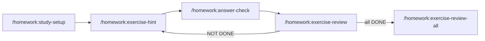

# Homework with a local brief

Use this workflow when the exercises are in a `README.md` or a text file in the folder, for example a Python assignment from a course.

## Commands

1. `/homework:study-setup` once. It adds `.homework/` to `.gitignore`, finds the brief, and asks for the language, subject, criteria and resources. The mode is `strict`.
2. `/homework:exercise-hint 3` when stuck on exercise 3.
3. `/homework:answer-check` to know whether an answer is right, without seeing the correct one.
4. `/homework:exercise-review 3` once the exercise looks finished.
5. `/homework:exercise-review-all` for an overview before handing in.

## Sample exchange

> **Student:** /homework:exercise-hint 3
>
> **Agent:**
> 1. The goal is to count how many times each word appears in the text.
> 2. The concept is a *dictionary* (a structure that maps a key to a value).
> 3. Read: https://docs.python.org/3/tutorial/datastructures.html#dictionaries
> 4. What should happen the first time a word is met, when it is not in the dictionary yet?

> **Student:** /homework:exercise-review 3
>
> **Agent:**
> **Status:** NOT DONE
> **Score:** 3/5
>
> The counting works and the function is well named. Upper-case and lower-case words are counted separately, while the brief asks to ignore case.
>
> 1. "The" and "the" give two entries. Where could the text be normalised before counting? https://docs.python.org/3/library/stdtypes.html#str.lower

## What the agent does not do

- Give the answer, the corrected line or the final code.
- Ask for resources again after setup.
- Explain a topic during a review: `/homework:topic-explain` is there for that.
