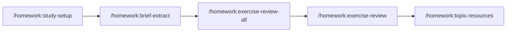

# Homework from a PDF

Use this workflow when the brief or the course material is a PDF, a photo or a docx file, for example a scanned statistics worksheet.

## Commands



1. `/homework:study-setup`. No text brief is found, so setup offers to add files.
2. `/homework:brief-extract worksheet.pdf`. The file is converted to `.homework/resources/worksheet.md`, with page markers such as `<!-- page 2 -->`. If a page is unreadable, the agent asks for a clearer copy instead of guessing.
3. `/homework:exercise-review-all` for one line per exercise.
4. `/homework:exercise-review 4` for the details of one exercise.
5. `/homework:topic-resources standard deviation` for free material on a weak point.

## Sample exchange

> **Student:** /homework:exercise-review-all
>
> **Agent:**
> ```
> Exercise 1: DONE, 5/5. Mean and median are correct and justified.
> Exercise 2: DONE, 4/5. The method is right, the unit is missing.
> Exercise 3: NOT DONE, 1/5. Only the first step is written.
> Exercise 4: NOT DONE, 2/5. The variance is computed, not the standard deviation.
> ```

> **Student:** /homework:topic-resources standard deviation
>
> **Agent:**
> - Seeing Theory, an interactive view of spread: https://seeing-theory.brown.edu/
> - Math is Fun, a step-by-step worked method: https://www.mathsisfun.com/
> - OpenLearn, a free introductory statistics course: https://www.open.edu/openlearn/

## What the agent does not do

- Guess a formula or a number it cannot read in the PDF.
- Commit the converted files: `.homework/` is ignored by git.
- Give the result of an exercise.
