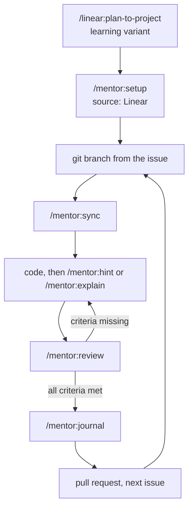

# Personal project with Linear

Use this workflow to learn a language by building a real project, with the plan in Linear and the agent as a mentor. The example builds a to-do CLI in Go.

The two plugins share the work: `linear` writes the plan once, and `mentor` reads it at every session. The agent then knows the project, the current task and the related documents without being told. There is no grade: the goal is to understand the concepts behind each task.

## Commands



1. **Plan once.** Describe the project, then run `/linear:plan-to-project` and ask for the learning variant. The agent shows the outline and creates nothing before approval. Each issue gets Objective, Concepts, Requirements, Steps, Success criteria, Hints and Documentation, plus Spec, Resources and Journal documents for the project.
2. **Set up the mentor once.** In the project's repository, run `/mentor:setup`. It reads the stack and the test command, asks for the learning goals, and links the Linear project.
3. **Start an issue.** Create the branch Linear suggests for it, for example `user/eng-12-add-the-list-command`.
4. **Sync.** `/mentor:sync` reads `ENG-12` from the branch name and copies the issue, its milestone and the project documents into `.mentor/linear/`.
5. **Work and ask.** Code, then use `/mentor:hint` when stuck, or `/mentor:explain` to understand a concept. The first hints come from the issue itself.
6. **Review.** `/mentor:review` runs the success criteria that only check (tests, build, `grep`), ticks the ones that are met, and names the concepts to deepen.
7. **Log the session.** `/mentor:journal` drafts a dated entry. It is appended to the Linear Journal only after approval.
8. **Next issue.** Open the pull request, create the next branch, and run `/mentor:sync` again.

## Sample exchange

> **Learner:** /mentor:hint
>
> **Agent:** The current issue is `ENG-12`, "Add the `list` command". In `cmd/list.go`, the error from `os.ReadFile` is printed, then the function keeps going with an empty slice.
>
> The concept is *error wrapping*: adding context to an error while keeping the original one. For example, on a different problem:
>
> ```go
> if err != nil {
>     return fmt.Errorf("open settings: %w", err)
> }
> ```
>
> - Errors in Go 1.13+: https://go.dev/blog/go1.13-errors
> - Package `errors`: https://pkg.go.dev/errors
>
> What should `list` return to its caller when the file cannot be read?

> **Learner:** /mentor:review
>
> **Agent:**
> **Criteria:** 3 of 4 met
>
> - [x] `go test ./...` passes: 6 tests, all green.
> - [x] `todo list` prints the tasks in order.
> - [x] A missing file gives an error and a non-zero exit code.
> - [ ] `gofmt -l .` returns nothing: `cmd/list.go` is listed. Which command formats it?
>
> **To deepen:** table-driven tests, since each case has its own test function. https://go.dev/wiki/TableDrivenTests
>
> **Next:** format the file, then open the pull request.

## What the agent does not do

- Write the code the issue asks for, or correct the learner's line. Examples are always on another problem.
- Give a grade.
- Write to Linear, except the journal entry after approval.
- Run a criterion that creates, deletes or publishes something without asking first.
