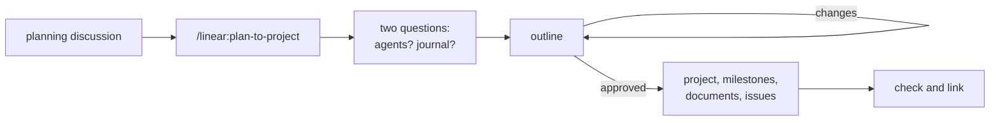

# Team project planning

Use this workflow to turn a planning discussion into a Linear project that any teammate can pick up, for example a migration planned in a meeting.

## Commands

1. **Discuss the plan** in the conversation: goal, scope, decisions, phases and dependencies.
2. **Run `/linear:plan-to-project`.** The standard variant is used unless the learning variant is asked for.
3. **Answer two questions:** will AI agents work on the issues (they then get an "Agent notes" block), and should a Journal document be created.
4. **Review the outline:** project name and summary, milestones, and issue titles with priorities and dependencies. Nothing exists in Linear yet.
5. **Approve.** The agent creates the project, milestones, documents and issues, in that order, with "blocked by" relations.
6. **Check.** The agent re-reads everything (language, tone, priorities, relations, dates) and gives the project link.

## Sample exchange

> **User:** /linear:plan-to-project
>
> **Agent:** Two questions first. Will AI agents work on these issues? Should a Journal document track progress?
>
> **User:** Yes to agents, no journal.
>
> **Agent:** Outline:
>
> **Migrate the billing service** · lead: you · summary: move billing from the monolith to its own service, for the platform team.
>
> **Phase 1 · Read path**
> - Expose invoices through the new service (High, blocks 2 issues)
> - Add contract tests for the invoice API (High)
>
> **Phase 2 · Write path**
> - Move invoice creation (Medium, blocked by "Expose invoices…")
>
> Create it as is, or change something?

## What the agent does not do

- Create anything in Linear before the outline is approved.
- Address the reader as "you" or name a person in the issues: roles only, in a neutral tone.
- Put number prefixes in titles: order comes from milestones and "blocked by" relations.
